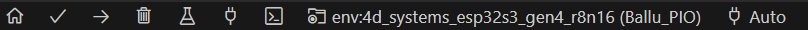

# A31301 Finger Sensor Reader Firmware

ESP32-S3 firmware that reads the 16 A31301 Hall-effect sensors on the MERLIN finger sensor board and shows live X, Y, Z field values on the OLED.

## Origin

This firmware is adapted from the BALLU PlatformIO firmware (v2.3.3, Gen2 board). It runs on the same ESP32-S3 Gen2 board and keeps that project's OLED menu system, battery monitoring and soft power switch.

### What changed from the original

**Removed**
- Xbox controller over BLE (JoystickBLE, BLEBridge)
- ESP-NOW hub, pair master and pair slave roles (ESPNowBridge, PM_HubPairing, hub_role build)
- LoRa link
- Servo control and RGB LED control
- PC serial control protocol (PCSerialControl) and the serial sensor stream
- Bridge and role settings stored in NVS
- `ballu_gen1` and `hub_role` build environments

**Kept**
- OLED menu and button handling (OLED_Display, MenuConfig)
- Battery monitoring through the INA219 (Battery page)
- Soft power switch and 2 s long-press shutdown

**Added or changed**
- Support for 16 A31301 sensors at 0x60 to 0x6F (was 9)
- Main menu lists every sensor directly
- Live sensor page with sensor cycling and selectable units (raw, mT, Gauss)

## Hardware

| Item | Value |
|---|---|
| Host board | BALLU Gen2 (ESP32-S3, `4d_systems_esp32s3_gen4_r8n16`) |
| I2C | SDA = GPIO 11, SCL = GPIO 10, 400 kHz |
| Sensors | 16× A31301 on one shared bus with the OLED |
| Buttons | UP = GPIO 40, DOWN = GPIO 38, ENTER = GPIO 41, BACK = GPIO 39, POWER = GPIO 47 |

Pin definitions are in `include/PinsGen2.h`.

## Build and flash

Requirements:
- VS Code
- PlatformIO extension and PlatformIO Core

Steps:
1. Open the `firmware/` folder in VS Code.
2. Check the environment is `env:ballu_gen2` (the default).
3. Click Build (check mark).
4. Connect the board over USB-C while holding the reset button.
5. Click Upload (right arrow).



Command line equivalents:

```
pio run -e ballu_gen2
pio run -e ballu_gen2 -t upload
pio device monitor -b 115200
```

Upload without rebuilding:

```
pio run -t nobuild -t upload
```

### If upload fails
1. Unplug, then replug while holding reset. The screen should stay off.
2. Set the serial port manually instead of auto.
3. Use a USB-C cable that supports data, not a charge-only cable.

## Usage

The main menu shows:

```
S0: 0x60
S1: 0x61
...
S15: 0x6F
Battery %
Shutdown
```

- Select a sensor with ENTER to open its live page.
- On the live page, push the joystick down for the next sensor and up for the previous one (wraps 0 to 15).
- Press BACK to return to the main menu.
- Hold the center button for 2 s to power off.

## What the firmware reads

For the selected sensor, every refresh (default 100 ms, about 10 Hz) the firmware:

1. Checks the sensor answers at its I2C address (shown as Connected or Disconnected).
2. Reads the X, Y and Z magnetic field channels.

| Channel | Registers (MSB, LSB) |
|---|---|
| X | 0x1E, 0x1F |
| Y | 0x20, 0x21 |
| Z | 0x22, 0x23 |

Each channel is a 15-bit two's complement value. The firmware sign-extends bit 14 into bit 15, so each reading is a signed 16-bit integer from -16384 to +16383.

### Display format

```
S5 @0x65
Connected
X: 1234
Y: -56
Z: 7890
```

- Line 1: sensor index (S0 to S15) and its I2C address
- Line 2: whether the sensor responded
- Lines 3 to 5: X, Y, Z in the selected unit

### Units

| Setting | Output | Conversion |
|---|---|---|
| `SensorUnits::RAW` (default) | Raw counts | none |
| `SensorUnits::MILLITESLA` | mT, 3 decimals | counts / 81.967 |
| `SensorUnits::GAUSS` | G, 3 decimals | counts / 81.967 × 10 |

81.967 counts/mT (about 8.2 counts/G) matches the ±2000 G (-20) variant, where full scale (16384 counts) is about 200 mT.

Units, conversion factor and refresh period are set in `src/main.cpp`:

```cpp
SensorUnits gSensorUnits = SensorUnits::RAW;
float       gCountsPerMilliTesla = 81.967213f;  // counts per mT
uint32_t    gSensorPagePeriodMs = 100;          // ~10 Hz OLED page
```

### Mapping sensor index to board position

Sensor `Sn` has address `0x60 + n`, which is chip `U(n+1)` at board position `[n/4 x n%4]`. For example, S6 = 0x66 = U7 = [1x2]. See the address table in the root README.

## Limitations

- Readings are shown on the OLED only. Serial prints a startup message at 115200 baud and nothing else.
- One sensor is displayed at a time.
- X, Y and Z are read in separate I2C transactions, so the three channels are not sampled at exactly the same instant.
- No zero-offset calibration. Values include the magnet's resting field and any board offset.

## File map

| File | Purpose |
|---|---|
| `src/main.cpp` | Setup, sensor array definition, display settings |
| `include/A31301.h`, `src/A31301.cpp` | A31301 I2C driver |
| `src/SensorDisplay.cpp` | Live sensor page and battery page |
| `src/MenuConfig.cpp` | Main menu layout |
| `src/OLED_Display.cpp` | OLED drawing and menu navigation |
| `src/Battery*.cpp`, `src/INA219SoCSensor.cpp` | Battery monitoring |
| `src/SoftPowerSwitch.cpp`, `src/Utilities.cpp` | Power switch and long-press shutdown |
| `include/PinsGen2.h` | Board pin definitions |
